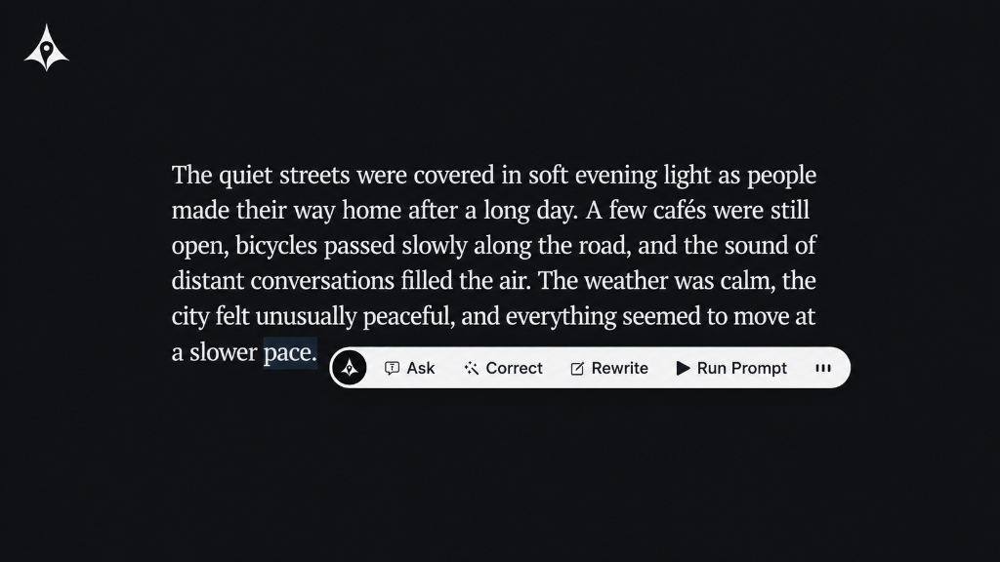

# Plyph

Use AI on selected text anywhere in GNOME.

Correct writing, rewrite text, translate, summarize, fix code, or create your own actions. Select some text, trigger an action, and Plyph can preview or paste the result back automatically.



## Features

- Correct and rewrite selected text
- Run selected text directly as a prompt
- Create unlimited custom actions
- Use `${language}`, `${tone}`, `${style}`, and `${selection}` variables
- Override provider and model per custom action
- Configure input and output token limits for long actions
- Preview results before replacing text
- Undo the last automatic replacement
- Reorder or hide custom actions
- Open actions from the panel or a keyboard action palette
- Run locally with Ollama, LM Studio, or another OpenAI-compatible server, or use supported cloud providers
- Sign in with ChatGPT to use your ChatGPT plan without an API key or helper process
- API credentials stored securely through the system Secret Service

Supported providers:

- Ollama
- OpenAI-compatible servers, including LM Studio
- Cloudflare Workers AI
- B.AI
- Groq
- Gemini
- OpenRouter
- Cerebras
- OpenAI
- Vercel AI Gateway
- ChatGPT Account

## Installation

Install Plyph from [GNOME Shell Extensions](https://extensions.gnome.org/extension/10540/ai-autocorrect/).

Supports GNOME Shell 46–51.

After installation, open the extension settings to choose your provider and model, connect your account or add API credentials, and configure shortcuts and actions.

### Manual installation

```bash
git clone https://github.com/ubaimutl/Plyph.git
cd Plyph
gnome-extensions pack --force \
  --extra-source=actions.js \
  --extra-source=ai.js \
  --extra-source=models.js \
  --extra-source=secrets.js \
  --extra-source=chatgpt.js \
  --extra-source=chatgptProtocol.js \
  --extra-source=diff.js \
  --extra-source=stylesheet.css \
  --extra-source=icons \
  --extra-source=LICENSE \
  --schema=schemas/org.gnome.shell.extensions.ai-autocorrect.gschema.xml
gnome-extensions install --force ai-autocorrect@ubai.dev.shell-extension.zip
```

Log out and back in, then enable the extension:

```bash
gnome-extensions enable ai-autocorrect@ubai.dev
```

## Providers

### Local servers and API providers

Add the provider's required API key or token in the extension settings:

- Ollama: https://ollama.com
- Cloudflare Workers AI: https://developers.cloudflare.com/workers-ai/get-started/rest-api/
- B.AI: https://b.ai/
- Groq: https://console.groq.com/keys
- Gemini: https://ai.google.dev/aistudio
- OpenRouter: https://openrouter.ai/keys
- Cerebras: https://cloud.cerebras.ai
- OpenAI: https://platform.openai.com/api-keys
- OpenAI-compatible: set the base URL for LM Studio or another compatible server. LM Studio commonly uses `http://127.0.0.1:1234/v1`.
- Vercel AI Gateway: https://vercel.com/ai-gateway

Plyph itself does not charge anything. Provider pricing and free-tier limits depend on the provider and may change.

Providers with useful free usage options include:

- Cloudflare Workers AI: 10,000 Neurons per day on Workers Free.
- B.AI: DeepSeek V4 Flash is currently free; availability and limits may change.
- Groq: free plan available; limits vary by model and account.
- Cerebras: free plan available; limits vary by model and account.
- Vercel AI Gateway: free accounts receive $5 of credit every 30 days after the first request.

Check the provider's website for current limits and billing terms before selecting a model.

### ChatGPT sign-in

Use your ChatGPT plan directly in Plyph with native GNOME sign-in.

1. Open Plyph settings and choose **ChatGPT Account** as the active provider.
2. Click **Continue with ChatGPT** and finish signing in through your browser.
3. Return to Plyph and choose a model. Use **Refresh models** if needed.
4. Select text and run an action as usual.

You can add and switch between saved accounts, or sign out in settings. Credentials are stored securely in the system keyring, and access tokens refresh automatically.

Requests use your shared ChatGPT allowance. Open **Manage usage** to review usage and account access. Available models depend on your account.

For ChatGPT actions, set the output token limit to **Auto**. Explicit output token limits are not supported.

## Custom actions

Custom actions can use the active provider and model or override them individually.

Each custom action can treat selected text as content to transform or as the user prompt itself. Prompt-mode actions send the exact selection as the user message and can add optional system guidance. The built-in Run selected prompt action can also override its provider, model, and token limits.

They can also define optional input and output token limits.

**Input limits** use a lightweight token estimate and stop the action before sending if the selection is too large. Plyph never truncates selected text.

**Output limits** control the maximum response size requested from providers that support them. `Auto` starts at 1000 tokens and grows with the selected text, up to 2000 tokens. For **ChatGPT Account**, use `Auto`; response length is managed by ChatGPT.

If a provider indicates that a response was cut off because the output limit was reached, Plyph rejects the partial result and asks you to increase the limit.

### Debugging failed AI requests

Enable **Debug AI requests** in Settings to write the provider, model, estimated input size, requested output limit, sanitized endpoint, and HTTP status to the GNOME system log. Plyph does not log selected text, prompts, API keys, authorization headers, or response bodies.

View the entries while reproducing the issue with:

```bash
journalctl -f /usr/bin/gnome-shell | grep Plyph
```

## Action palette

The **Open actions** shortcut can display your actions:

- centered on the active monitor
- near the pointer
- or through the normal panel menu

This makes custom actions available without moving the pointer to the top panel.

## Privacy

Clipboard or selected text is sent to your chosen provider only when you explicitly run an action.

Using previously copied clipboard text as a fallback is optional and disabled by default.

API keys and tokens are stored through the system Secret Service and can be managed with GNOME Passwords and Keys. Credentials stored by older Plyph versions are migrated automatically and removed from GSettings after successful migration.

When using Ollama, LM Studio, or another local OpenAI-compatible server, selected text is processed locally instead of being sent to an online AI provider.

Cloud providers have their own data-retention, privacy, usage-limit, and pricing policies. Review the policy of the provider and model you choose before sending sensitive information.

## Selection capture

GNOME normally exposes selected text through the PRIMARY selection.

Firefox on Wayland can behave differently, so Plyph enables explicit-copy compatibility for Firefox by default. In this mode Plyph sends `Ctrl+C`, which temporarily changes the normal clipboard.

Other application IDs can be added in Settings if needed.

## Result handling

AI responses can be incorrect. Enable **Preview before replacing** if you want to inspect generated text first.

After an automatic replacement, **Undo last replacement** remains available in the panel menu for 60 seconds and uses the target application's native undo action.
