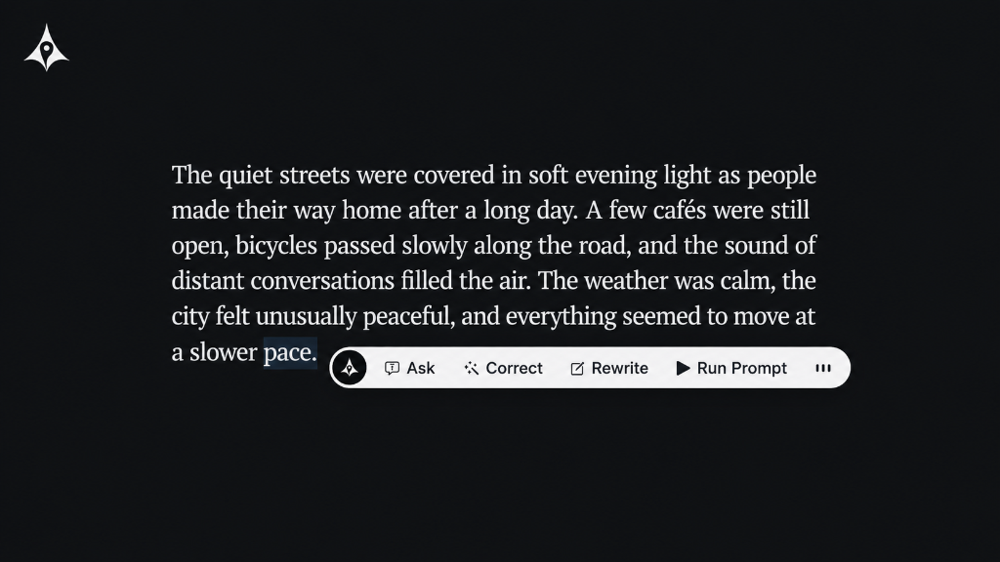

# Plyph

Use AI on selected text anywhere in GNOME.

Correct writing, rewrite text, translate, summarize, fix code, or create your own actions. Select some text, trigger an action, and Plyph can preview or paste the result back automatically.



## Features

- Correct and rewrite selected text
- Run selected text directly as a prompt
- Create unlimited custom actions
- Use `${language}`, `${tone}`, `${style}`, and `${selection}` variables
- Override provider and model per custom action
- Configure input and output token limits for long actions
- Include optional personal context with any action
- Preview results before replacing text
- Refine results with follow-up instructions and browse earlier revisions
- Discuss a result without changing it, with formatted replies and individual copy controls
- Enlarge the preview and resize the result and discussion panes
- Undo the last automatic replacement
- Reorder or hide custom actions
- Open actions from the panel or a keyboard action palette
- Run locally with Ollama, LM Studio, or another OpenAI-compatible server, or use supported cloud providers
- Sign in with ChatGPT to use your ChatGPT plan without an API key or helper process
- API credentials stored securely through the system Secret Service

Supported providers:

- Ollama
- OpenAI-compatible servers, including LM Studio
- Cloudflare Workers AI
- B.AI
- Groq
- Gemini
- OpenRouter
- Cerebras
- OpenAI
- Vercel AI Gateway
- ChatGPT Account

## Installation

Install Plyph from [GNOME Shell Extensions](https://extensions.gnome.org/extension/10540/ai-autocorrect/).

Supports GNOME Shell 46–51.

After installation, open the extension settings to choose your provider and model, connect your account or add API credentials, and configure shortcuts and actions.

In **Instructions → Personal context**, you can add background such as “I use Linux, work mainly with Python, and prefer brief explanations.” It is included with all actions by default. Leave it empty to preserve existing behavior, or disable **Use personal context** for a built-in action or under a custom action’s **Advanced options**. Specific requests and action instructions take priority; unrelated context is ignored.

### Manual installation

```bash
git clone https://github.com/ubaimutl/Plyph.git
cd Plyph
gnome-extensions pack --force \
  --extra-source=actions.js \
  --extra-source=ai.js \
  --extra-source=models.js \
  --extra-source=secrets.js \
  --extra-source=chatgpt.js \
  --extra-source=chatgptProtocol.js \
  --extra-source=diff.js \
  --extra-source=markdown.js \
  --extra-source=shell \
  --extra-source=stylesheet.css \
  --extra-source=icons \
  --extra-source=LICENSE \
  --schema=schemas/org.gnome.shell.extensions.ai-autocorrect.gschema.xml
gnome-extensions install --force ai-autocorrect@ubai.dev.shell-extension.zip
```

Log out and back in, then enable the extension:

```bash
gnome-extensions enable ai-autocorrect@ubai.dev
```

## Providers

### Local servers and API providers

Add the provider's required API key or token in the extension settings:

- Ollama: https://ollama.com
- Cloudflare Workers AI: https://developers.cloudflare.com/workers-ai/get-started/rest-api/
- B.AI: https://b.ai/
- Groq: https://console.groq.com/keys
- Gemini: https://ai.google.dev/aistudio
- OpenRouter: https://openrouter.ai/keys
- Cerebras: https://cloud.cerebras.ai
- OpenAI: https://platform.openai.com/api-keys
- OpenAI-compatible: set the base URL for LM Studio or another compatible server. LM Studio commonly uses `http://127.0.0.1:1234/v1`.
- Vercel AI Gateway: https://vercel.com/ai-gateway

### ChatGPT sign-in

Use your ChatGPT plan directly in Plyph with native GNOME sign-in.

1. Open Plyph settings and choose **ChatGPT Account** as the active provider.
2. Click **Continue with ChatGPT** and finish signing in through your browser.
3. Return to Plyph and choose a model. Use **Refresh models** if needed.
4. Select text and run an action as usual.

You can add and switch between saved accounts, or sign out in settings. Credentials are stored securely in the system keyring, and access tokens refresh automatically.

Available models depend on your account.

For ChatGPT actions, set the output token limit to **Auto**. Explicit output token limits are not supported.

## Custom actions

Custom actions can use the active provider and model or override them individually.

Each custom action can treat selected text as content to transform or as the user prompt itself. Prompt-mode actions send the exact selection as the user message and can add optional system guidance. The built-in Run selected prompt action can also override its provider, model, and token limits.

They can also define optional input and output token limits.

**Input limits** use a lightweight token estimate and stop the action before sending if the selection is too large. Plyph never truncates selected text.

**Output limits** control the maximum response size requested from providers that support them. `Auto` starts at 1000 tokens and grows with the selected text, up to 2000 tokens. For **ChatGPT Account**, use `Auto`; response length is managed by ChatGPT.

If a provider indicates that a response was cut off because the output limit was reached, Plyph rejects the partial result and asks you to increase the limit.

### Debugging failed AI requests

Enable **Advanced → Diagnostics → Log request diagnostics** in Settings to write the provider, model, estimated input size, requested output limit, sanitized endpoint, and HTTP status to the GNOME system log. Plyph does not log selected text, prompts, API keys, authorization headers, or response bodies.

View the entries while reproducing the issue with:

```bash
journalctl -f /usr/bin/gnome-shell | grep Plyph
```

## Action palette

The **Open actions** shortcut can display your actions:

- centered on the active monitor
- near the pointer
- or through the normal panel menu

This makes custom actions available without moving the pointer to the top panel.

## Privacy

Clipboard or selected text is sent to your chosen provider only when you explicitly run an action or submit a refinement or discussion question. Personal context is included when enabled for that action.

Discussion requests include the source text, action details, initial result, conversation history, and the current result and revision associated with each question.

Using previously copied clipboard text as a fallback is optional and disabled by default.

API keys and tokens are stored through the system Secret Service and can be managed with GNOME Passwords and Keys. Credentials stored by older Plyph versions are migrated automatically and removed from GSettings after successful migration.

When using Ollama, LM Studio, or another local OpenAI-compatible server, selected text is processed locally instead of being sent to an online AI provider.

Cloud providers have their own data-retention, privacy, usage-limit, and pricing policies. Review the policy of the provider and model you choose before sending sensitive information.

## Selection capture

GNOME normally exposes selected text through the PRIMARY selection.

Firefox on Wayland can behave differently, so Plyph enables explicit-copy compatibility for Firefox by default. In this mode Plyph sends `Ctrl+C`, which temporarily changes the normal clipboard.

Other application IDs can be added in Settings if needed.

## Result handling

AI responses can be incorrect. Enable **Preview before replacing** if you want to inspect generated text first.

The result can be edited before you use **Copy** or **Replace**. **Show changes** compares the result with the original selection when available. **Wrap** controls line wrapping, and **Enlarge preview** opens a bounded larger view instead of filling the screen.

### Refine

Open **Refine**, enter an instruction, and submit it to create another revision. The previous and next controls let you browse revisions while keeping manual edits. Copying or replacing uses the result currently displayed.

### Discuss

Open **Discuss** to ask about the result. The conversation stays hidden until you open it and scrolls independently of the result. Replies display Markdown formatting when provided and remain read-only. Select part of a reply and press `Ctrl+C`, or use the copy icon beneath it to copy the complete reply, preserving Markdown and code.

Discussion does not change the result. Use **Refine** to apply a follow-up instruction. With a conversation visible, drag the divider to adjust the space between the result and discussion. Focus the divider and use `Up` or `Down` to resize it with the keyboard, or `Home` to reset it.

After an automatic replacement, **Undo last replacement** remains available in the panel menu for 60 seconds and uses the target application's native undo action.

## Development checks

Run the automated tests from the repository root:

```bash
node --test tests/*.test.cjs
```

The compatibility tests exercise GNOME Shell 46–51 API branches with mocks. To also run the native interaction test in a separate headless compositor with temporary settings:

```bash
PLYPH_NATIVE_SHELL_TEST=1 node --test tests/*.test.cjs
```

The native test requires GNOME Shell with headless Wayland support and checks clipboard shortcuts, visible text selection, reply copying, pane dragging, and empty Ask submissions. The latest native verification was on GNOME Shell 51.1; GNOME 46–50 still need real-session smoke tests before release. Check the same interactions, settings layout, themes, and display scaling on those versions.

After building the ZIP using the manual installation command, run Shexli against the package:

```bash
shexli --format json ai-autocorrect@ubai.dev.shell-extension.zip
```

Shexli 0.2.1 requires manual review for clipboard access and incorrectly flags GNOME 51 because its version rule caps releases at 50. These findings need to be assessed against the declared clipboard behavior and the current GNOME release calendar.
