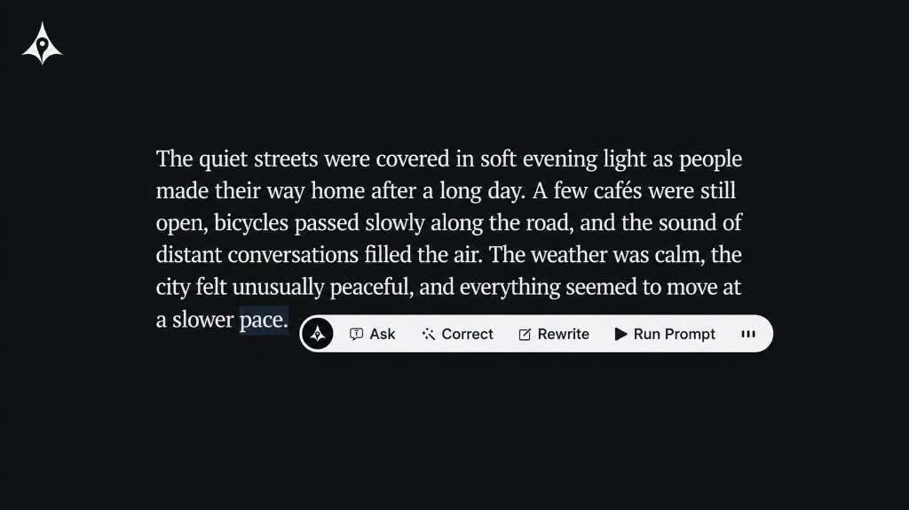

# Plyph

Use AI on selected text anywhere in GNOME.

Select text, choose an action, and preview, copy, or replace the result. Plyph can correct writing, rewrite text, translate, summarize, work with code, or run your own prompts.



## Features

- **Work with selected text:** correct, rewrite, ask questions, or run selected text as a prompt.
- **Create custom actions:** define your own instructions, variables, provider, model, and input/output limits.
- **Use different AI services:** connect a local server, sign in with ChatGPT, or save multiple OpenAI-compatible providers with separate URLs, keys, and models.
- **Check before replacing:** preview, edit, compare, copy, or replace the result, with an option to undo the last automatic replacement.
- **Keep working with a result:** refine it through revisions or discuss it without changing the text.
- **Choose how to launch actions:** use the selection toolbar, panel menu, shortcuts, or action palette. The selection toolbar is enabled by default; an existing saved opt-out is preserved.

Supports **GNOME Shell 46–51**.

## Installation

Install Plyph from [GNOME Shell Extensions](https://extensions.gnome.org/extension/11799/plyph/).

Then open its settings to choose a provider and model, set up credentials if needed, and configure your actions or shortcuts.

To install from source, see [Manual installation](#manual-installation).

## AI providers

Plyph supports dedicated connections for **ChatGPT Account, Ollama, Gemini, and Cloudflare Workers AI**. Other services that expose an OpenAI-compatible API can be added as saved providers.

### Saved OpenAI-compatible providers

Go to **General → Saved providers → Add provider**. Start with a preset or enter a name and base URL. Add an API key if the service needs one; the default model is optional while setting up the connection.

After saving, use **Refresh models** to choose a model, or enter a model ID manually if the service doesn't provide a model list. A model must be selected before running an action.

**Advanced** is collapsed by default. It offers optional temperature, reasoning effort, custom HTTP headers, and extra JSON request parameters. Leave these blank to keep provider defaults. Header values are stored in the system keyring; extra request parameters are ordinary settings and should contain no credentials. Explicit temperature and reasoning selections take precedence over the same fields in the extra JSON. Plyph retains control of the conversation, selected model, streaming mode, and action token limits.

You can save multiple connections to the same or different services. Each has its own endpoint, credentials, and model, and can be selected as the active provider or used by an individual action.

Presets are available for **Groq, B.AI, OpenRouter, Cerebras, OpenAI, LM Studio (local), Vercel AI Gateway**, and other compatible servers. You can also enter any compatible endpoint, such as LM Studio (`http://127.0.0.1:1234/v1`). A preset fills in connection details; it doesn't require a separate built-in integration.

Preset-specific compatibility options apply only to the preset's original base URL. Changing it to a different endpoint uses standard OpenAI-compatible requests.

The **LM Studio (local)** preset fills in `http://127.0.0.1:1234/v1`. Use **Custom connection** for other compatible services. Existing connections using the old default name still appear as **OpenAI-compatible (legacy)**; custom names, URLs, models, IDs, and credentials are preserved.

**Upgrading from an older version:** Plyph imports existing configured providers automatically, keeping their provider IDs, model selections, action overrides, and keyring credentials. Services you haven't configured remain available as presets. If a provider is in use as the active provider or by an action, reassign it before deleting it.

### ChatGPT Account

You can use your ChatGPT plan through Plyph without an API key or a helper process:

1. Choose **ChatGPT Account** as the active provider.
2. Select **Continue with ChatGPT** and complete sign-in in your browser.
3. Return to Plyph and select a model; use **Refresh models** if needed.

You can switch between saved accounts or sign out in settings. Account credentials are stored in the system keyring, and access tokens refresh automatically. Available models depend on your account.

For ChatGPT actions, leave the output token limit on **Auto**; explicit output limits aren't supported.

### Provider setup links

- [Ollama](https://ollama.com)
- [Cloudflare Workers AI](https://developers.cloudflare.com/workers-ai/get-started/rest-api/)
- [B.AI](https://b.ai/)
- [Groq](https://console.groq.com/keys)
- [Gemini](https://ai.google.dev/aistudio)
- [OpenRouter](https://openrouter.ai/keys)
- [Cerebras](https://cloud.cerebras.ai)
- [OpenAI](https://platform.openai.com/api-keys)
- [Vercel AI Gateway](https://vercel.com/ai-gateway)

## Actions and results

### Custom actions

Create actions for your own workflows, with custom instructions and optional provider or model overrides, including saved OpenAI-compatible providers.

Use `${language}`, `${tone}`, `${style}`, and `${selection}` variables. Actions can transform selected text or use it directly as a prompt.

**Input limits** prevent oversized requests and help control API costs without truncating text. **Output limits** control response length; incomplete responses are rejected rather than returned. With Gemini, **Auto** leaves the limit to the model, and an explicit limit also covers the tokens the model spends thinking.

Optional **personal context** can be added under **Instructions → Personal context** and disabled for individual actions.

### Preview, refine, and discuss

Enable **Preview before replacing** to inspect results before they go back to your app. In the preview you can edit the text, show changes against the original selection, control line wrapping, enlarge the view, or copy or replace the result.

- **Refine:** give another instruction and move between revisions without losing your manual edits.
- **Discuss:** ask follow-up questions about a result without changing it. Replies support Markdown and individual copy controls.
- **Undo:** after automatic replacement, the panel menu offers **Undo last replacement** for 60 seconds using the target application's native undo.

### Action palette

The **Open actions** shortcut can show actions in the center of the active monitor, near the pointer, or in the panel menu. This lets you run actions without moving the pointer to the top panel.

## Privacy and text selection

Selected or clipboard text is sent to the chosen AI provider only when you run an action or submit a refine/discuss request. If enabled, personal context is included with those requests. Discussion requests also include the source text, action details, relevant results and revisions, and conversation history.

API keys and tokens are stored with the system Secret Service (viewable in GNOME Passwords and Keys). If a saved key is locked, running an action requests the system unlock prompt; canceling it stops the request. In provider settings, use **Unlock** to load a locked key. You don't need to enter the API key again. Older credentials are migrated out of GSettings after successful keyring storage. Local services such as Ollama and LM Studio process text locally; cloud services have their own privacy, retention, and pricing policies.

Plyph normally reads GNOME's PRIMARY selection. On Wayland, Firefox may need explicit copying, which Plyph enables for Firefox by default. This sends `Ctrl+C` and temporarily changes the regular clipboard. You can configure additional application IDs in settings. Using previously copied clipboard text as a fallback is optional and disabled by default.

AI responses can be incorrect, so review important changes before replacing text.

## Troubleshooting

Enable **Advanced → Diagnostics → Log request diagnostics** to log the provider, model, estimated input size, output limit, sanitized endpoint, and HTTP status. Plyph does not log selected text, prompts, API keys, authorization headers, or response bodies.

To watch GNOME Shell logs while reproducing an issue:

```bash
journalctl -f /usr/bin/gnome-shell | grep Plyph
```

When reporting a problem, include your GNOME Shell version, the steps to reproduce it, and any relevant diagnostic message. Don't include API keys or private text.

## Contributing

Contributions are welcome, whether that's bug fixes, docs, usability improvements, or new features.

- **Bigger changes:** For larger features, it's helpful to open an issue first.
- **Existing functionality:** A quick look for similar features helps avoid duplicates. Fewer dependencies is better.
- **Providers:** Services with an OpenAI-compatible API usually work through saved providers, so a new hardcoded one is only needed if the API behaves differently.
- **Compatibility:** Please try not to break existing users' saved actions, provider IDs, credentials, or supported GNOME Shell versions.
- **Privacy:** Please avoid adding telemetry, exposing credentials, or sending text to new destinations without a clear user action.
- **Testing:** A quick note on how you checked your change is helpful. Screenshots are welcome for UI changes.

## Development checks

Run the automated tests from the repository root:

```bash
node --test tests/*.test.cjs
```

For the optional native interaction test in a headless GNOME Shell session:

```bash
PLYPH_NATIVE_SHELL_TEST=1 node --test tests/*.test.cjs
```

The compatibility suite covers GNOME Shell 46–51 API branches with mocks. Native interaction checks require GNOME Shell with headless Wayland support; the native keyring check also requires `gnome-keyring-daemon` and uses a private Secret Service with temporary credentials. Real-session testing is still important across supported GNOME versions, especially for selection handling, shortcuts, preferences, theming, and display scaling.

After packaging, you can inspect the ZIP with Shexli:

```bash
shexli --format json ai-autocorrect@ubai.dev.shell-extension.zip
```

Shexli 0.2.1 has known limitations around clipboard-access review and GNOME 51 version detection; assess its warnings rather than treating every finding as a confirmed issue.

### Manual installation

```bash
git clone https://github.com/ubaimutl/Plyph.git
cd Plyph
gnome-extensions pack --force \
  --extra-source=actions.js \
  --extra-source=ai.js \
  --extra-source=models.js \
  --extra-source=providers.js \
  --extra-source=secrets.js \
  --extra-source=chatgpt.js \
  --extra-source=chatgptProtocol.js \
  --extra-source=diff.js \
  --extra-source=markdown.js \
  --extra-source=shell \
  --extra-source=stylesheet.css \
  --extra-source=icons \
  --extra-source=LICENSE \
  --schema=schemas/org.gnome.shell.extensions.ai-autocorrect.gschema.xml
gnome-extensions install --force ai-autocorrect@ubai.dev.shell-extension.zip
```

Log out and back in, then enable the extension:

```bash
gnome-extensions enable ai-autocorrect@ubai.dev
```

## License

See [LICENSE](LICENSE).
